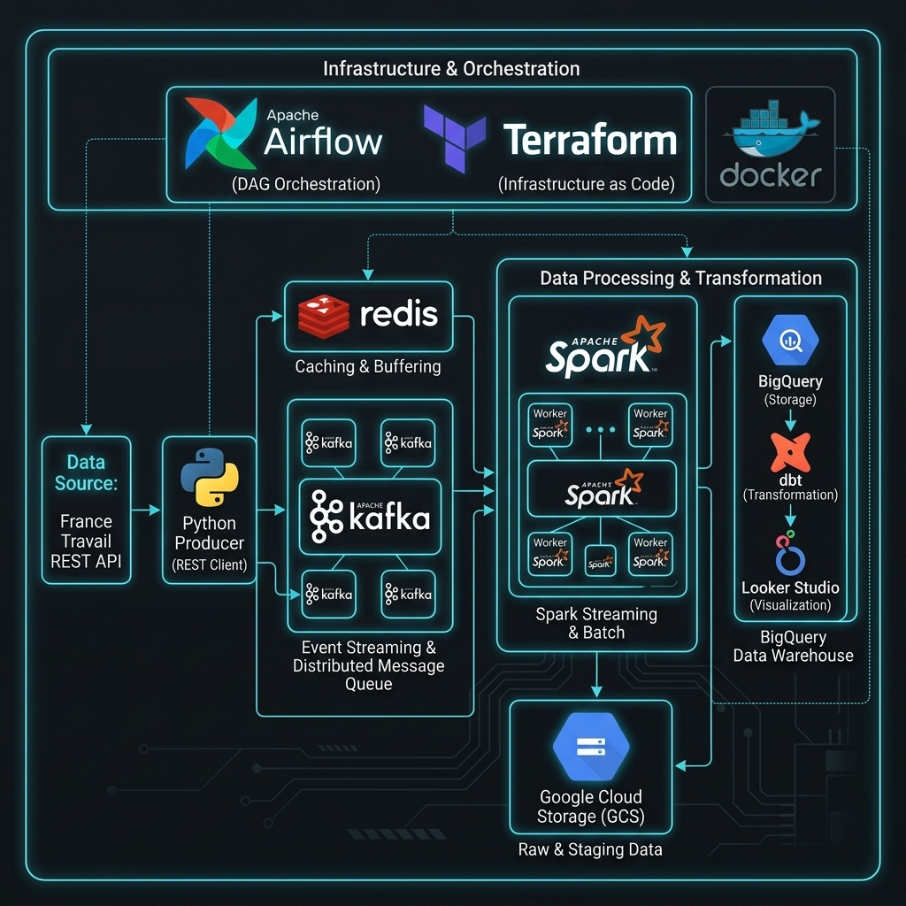

# 🇫🇷 French IT Job Market — End-to-End Data Engineering Project

A production-grade data engineering pipeline that ingests, processes, and analyses **French IT job offers** from the [France Travail (Pôle Emploi) API](https://francetravail.io/data/api/offres-emploi) in real time.

It combines **Kafka streaming**, **Spark Structured Streaming**, **Change-Data-Capture (CDC)**, **dbt transformations on BigQuery**, and a **Looker Studio dashboard** — all orchestrated by **Apache Airflow** and provisioned with **Terraform**.

---

## 📐 Architecture



---

## 🛠 Tech Stack

| Layer | Technology |
|---|---|
| **Ingestion** | Python 3.12, France Travail REST API |
| **Message Broker** | Apache Kafka (Confluent 7.6, KRaft mode — no Zookeeper) |
| **CDC State Store** | Redis 7.2 |
| **Stream Processing** | Apache Spark 3.5 (Structured Streaming) |
| **Data Lake** | Google Cloud Storage (GCS) |
| **Data Warehouse** | Google BigQuery |
| **Transformation** | dbt-core with dbt-bigquery |
| **Orchestration** | Apache Airflow 2.9 |
| **Infrastructure** | Terraform (Google provider) |
| **Visualisation** | Google Looker Studio |
| **Containerisation** | Docker Compose |

---

## 📁 Project Structure

```
.
├── src/
│   ├── producer/
│   │   ├── backfill.py          # Day-1 historical load → Kafka
│   │   ├── cdc.py               # Incremental CDC sync → Kafka
│   │   ├── ft_client.py         # France Travail API wrapper
│   │   └── config.py            # ROME codes, environment config
│   └── streaming/
│       ├── spark_streaming_job.py   # Spark Structured Streaming entry point
│       ├── skill_extractor.py       # API + regex skill extraction
│       ├── salary_parser.py         # Salary normalisation → annual EUR
│       ├── location_enricher.py     # Commune/dept/region parsing
│       └── schemas.py               # Kafka event schema (StructType)
│
├── dbt/
│   ├── models/
│   │   ├── staging/             # stg_job_offers_clean, stg_job_skills_clean, stg_offer_expirations_clean
│   │   ├── intermediate/        # int_offer_lifecycle, int_active_offers, ...
│   │   └── marts/
│   │       ├── dim_date.sql
│   │       ├── dim_location.sql
│   │       ├── dim_company.sql
│   │       ├── dim_rome.sql
│   │       ├── fact_job_offers.sql
│   │       ├── fact_job_skills.sql
│   │       ├── schema.yml           # All dbt tests
│   │       └── reporting/
│   │           ├── mart_salary_analysis.sql
│   │           ├── mart_skill_demand.sql
│   │           ├── mart_geographical_overview.sql
│   │           ├── mart_offer_lifecycle.sql
│   │           └── mart_contract_type_distribution.sql
│   ├── seeds/
│   │   └── dept_region.csv      # French department → region mapping
│   └── packages.yml
│
├── airflow/
│   └── dags/
│       ├── dag_backfill_initial.py  # One-shot: full historical load
│       ├── dag_cdc_ingest.py        # Every 10 min: CDC poll → Kafka
│       ├── dag_dbt_transform.py     # Hourly: seed → staging → marts → test
│       └── dag_data_quality.py      # Daily: volume, null, duplicate, expire checks
│
├── terraform/
│   ├── main.tf                  # GCS bucket + BigQuery dataset
│   └── variables.tf
│
├── docker-compose.yaml
├── requirements.txt
└── .env                         # FT_CLIENT_ID, FT_CLIENT_SECRET, AIRFLOW_UID
```

---

## 🔄 Data Flow

### 1. Day-1 Backfill
The Python producer fetches all current IT job offers (12 ROME codes: M1801–M1813, M1405, E1206) from the France Travail API, publishes them as `INSERT` events to the **`it-job-offers-backfill`** Kafka topic, and seeds Redis with all active offer IDs + timestamps.

### 2. Real-Time CDC (every 10 minutes)
The CDC producer re-fetches the latest offers per ROME code and diffs against Redis:
- **New offer** → publish `INSERT` to `it-job-offers-cdc`
- **Changed offer** → publish `UPDATE`
- **Offer disappeared** → publish `EXPIRE`

### 3. Spark Structured Streaming
Spark consumes both Kafka topics every 30 seconds:
- Enriches each offer (salary normalisation, location parsing, skill extraction)
- Writes raw events to **GCS** (data lake)
- Writes structured rows to **BigQuery** staging tables with explicit schemas

### 4. dbt Transformation (hourly)
```
stg_* → int_* → dim_* + fact_* → mart_*
```
- **Staging**: cast, clean, dedup raw BigQuery tables
- **Intermediate**: resolve CDC lifecycle, identify active offers, compute lifetime days
- **Marts (Star Schema)**: `dim_date`, `dim_location`, `dim_company`, `dim_rome`, `fact_job_offers`, `fact_job_skills`
- **Reporting Marts**: pre-aggregated tables served directly to Looker Studio

### 5. Data Quality (daily)
Four automated checks: row volume, NULL rates on critical columns, duplicate PK detection, and EXPIRE event anomaly guard.

---

## 🚀 Quick Start

### Prerequisites
- Docker & Docker Compose
- A [France Travail API](https://francetravail.io) account (`FT_CLIENT_ID` + `FT_CLIENT_SECRET`)
- A GCP project with a service account key (BigQuery + GCS permissions)
- Terraform ≥ 1.5

### 1 — Clone & Configure

```bash
git clone <repo-url>
cd French_IT_Job_Market_DE_Project
```

Create a `.env` file:
```bash
FT_CLIENT_ID=your_france_travail_client_id
FT_CLIENT_SECRET=your_france_travail_client_secret
AIRFLOW_UID=50000
```

Place your GCP service account JSON at:
```
terraform/keys/mycreds.json
```

### 2 — Provision GCP Infrastructure

```bash
cd terraform
terraform init
terraform apply -var="credentials=./keys/mycreds.json"
cd ..
```

This creates:
- GCS bucket: `french-it-jobs-lake`
- BigQuery dataset: `french_it_jobs`

### 3 — Start All Services

```bash
docker compose up -d
```

Services started: `postgres`, `kafka`, `kafka-init` (topics), `redis`, `spark-jar-init` (downloads GCS/BQ jars), `spark`, `airflow-init`, `airflow-webserver`, `airflow-scheduler`

Verify everything is healthy:
```bash
docker compose ps
```

### 4 — Run the Day-1 Backfill

```bash
docker compose --profile backfill up producer
```

Expected output (~4,900 offers across 12 ROME codes):
```
═════════════════════════════════════════════
  BACKFILL SUMMARY
═════════════════════════════════════════════
  M1805      701 offers
  M1806      983 offers
  ...
  TOTAL        4912 offers
═════════════════════════════════════════════
```

Verify Redis:
```bash
docker exec french_it_job_market_de_project-redis-1 redis-cli SCARD active_offer_ids
# → ~5500
```

### 5 — Start Spark Streaming

```bash
 docker compose exec \
   -e ENABLE_CLOUD_SINK=true \
   -e GCS_KEY_FILE=/opt/spark/work-dir/keys/mycreds.json \
   spark bash -c "
     PYTHONPATH=/opt/spark/work-dir/src \
     /opt/spark/bin/spark-submit \
       --master 'local[2]' \
       --driver-memory 1g \
       --jars /opt/spark/extra-jars/guava-32.1.3-jre.jar,/opt/spark/extra-jars/gcs-connector-hadoop3-2.2.22-shaded.jar,/opt/spark/extra-jars/spark-bigquery-with-dependencies_2.12-0.36.1.jar \
       --packages org.apache.spark:spark-sql-kafka-0-10_2.12:3.5.0 \
       /opt/spark/work-dir/src/streaming/spark_streaming_job.py
   "
```

Tail logs:
```bash
docker exec french_it_job_market_de_project-spark-1 tail -f /tmp/spark_streaming.log
```

### 6 — Enable Airflow DAGs

Airflow UI: **http://localhost:8081** (login: `admin` / `admin`)

Enable DAGs in this order:

| DAG | Schedule | Purpose |
|---|---|---|
| `dag_backfill_initial` | `@once` | Already complete after Step 4 |
| `dag_cdc_ingest` | Every 10 min | Poll API → publish CDC events |
| `dag_dbt_transform` | Hourly | Transform staging → marts |
| `dag_data_quality` | Daily | Automated quality checks |

Trigger the first dbt run manually:
```bash
docker exec french_it_job_market_de_project-airflow-scheduler-1 \
  airflow dags trigger dag_dbt_transform
```

### 7 — Connect Looker Studio

1. Go to [lookerstudio.google.com](https://lookerstudio.google.com)
2. **Add data source → BigQuery → `french_it_jobs` dataset**
3. Connect the five `mart_*` reporting tables as separate data sources
4. Build dashboards using the mart tables (see [Dashboard Guide](#-dashboard-guide) below)

---

## 📊 Data Model

### Staging Layer

| Table | Description |
|---|---|
| `stg_job_offers` | Raw offers written by Spark from Kafka |
| `stg_job_skills` | Skills extracted per offer |
| `stg_offer_expirations` | EXPIRE CDC events |

### Star Schema (Marts)

| Table | Grain | Description |
|---|---|---|
| `dim_date` | 1 row/calendar date | Calendar dimension |
| `dim_location` | 1 row/commune+postal | Location hierarchy |
| `dim_company` | 1 row/company | Employer attributes |
| `dim_rome` | 1 row/ROME code | Occupation classification |
| `fact_job_offers` | 1 row/offer | Central fact (CDC lifecycle) |
| `fact_job_skills` | 1 row/offer+skill | Skill bridge table |

### Reporting Marts

| Mart | Powers |
|---|---|
| `mart_salary_analysis` | Salary distributions by experience, region, ROME, contract |
| `mart_skill_demand` | Top skills overall, by region, by ROME, by contract |
| `mart_geographical_overview` | Job density by region, department, commune |
| `mart_offer_lifecycle` | Avg/median time-to-fill by ROME, contract, region |
| `mart_contract_type_distribution` | CDI/CDD/Interim breakdown by ROME |

---

## 📈 Dashboard Guide

The Looker Studio dashboard has 4 pages:

**Page 1 — Market Overview & Geography** (`mart_geographical_overview`)
- KPI scorecards: total active offers, total all-time
- Google Maps bubble chart by department (set `dept_name` field type to **Geo → Region**)
- Top regions bar chart

**Page 2 — Skill Demand** (`mart_skill_demand`)
- Top 15 skills stacked bar (Required vs Desired)
- Skills × ROME pivot table (filter `analysis_type = 'by_rome'`)

**Page 3 — Salaries & Contracts** (`mart_salary_analysis` + `mart_contract_type_distribution`)
- Median annual salary by experience group
- Salary table: ROME × experience
- Contract distribution donut chart

**Page 4 — Market Dynamics** (`mart_offer_lifecycle`)
- Median time-to-fill by ROME code
- Fastest/slowest filling roles table

---

## 🔍 Monitoring & Quality

### Health Checks

```bash
# All services running?
docker compose ps

# Redis state
docker exec french_it_job_market_de_project-redis-1 redis-cli SCARD active_offer_ids

# Spark logs
docker exec french_it_job_market_de_project-spark-1 tail -50 /tmp/spark_streaming.log

# Airflow recent DAG runs
docker exec french_it_job_market_de_project-airflow-scheduler-1 \
  airflow dags list-runs --dag-id dag_cdc_ingest -o table
```

### Daily Data Quality Checks (`dag_data_quality`)

| Check | Threshold |
|---|---|
| Volume | `stg_job_offers` ≥ 100 rows |
| NULL rate | Critical columns < 5% NULL in `fact_job_offers` |
| Duplicates | Zero duplicate `offer_id` in `fact_job_offers` |
| EXPIRE anomaly | Expired rate < 10% of total (guards against Redis state corruption) |

### dbt Tests

Run manually:
```bash
docker exec french_it_job_market_de_project-airflow-scheduler-1 \
  bash -c "cd /opt/airflow/dbt && dbt test --project-dir /opt/airflow/dbt --profiles-dir /opt/airflow/dbt"
```

Tests cover: `not_null`, `unique`, `accepted_values`, and `relationships` (FK integrity) across all dimension, fact, and mart models.

---

## 🌍 ROME Codes Covered

| Code | Domain |
|---|---|
| M1801 | Administrateur / Administratrice réseau informatique |
| M1802 | Ingénieur / Ingénieure système informatique |
| M1803 | Directeur / Directrice des services informatiques -DSI- |
| M1804 | Ingénieur / Ingénieure télécoms |
| M1805 | Développeur / Développeuse web |
| M1806 | Consultant / Consultant(e) en informatique |
| M1810 | Technicien / Technicienne informatique |
| M1811 | Data Engineer |
| M1812 | Responsable de la Sécurité des Systèmes d'Information (RSSI) |
| M1813 | Intégrateur / Intégratrice logiciels métiers |
| M1405 | Data scientist |
| E1206 | UI - UX Designer |

---

## ⚙️ Environment Variables

| Variable | Where set | Description |
|---|---|---|
| `FT_CLIENT_ID` | `.env` | France Travail API client ID |
| `FT_CLIENT_SECRET` | `.env` | France Travail API client secret |
| `AIRFLOW_UID` | `.env` | UID for Airflow containers (use `id -u`) |
| `GOOGLE_APPLICATION_CREDENTIALS` | docker-compose | Path to GCP service account JSON |
| `ENABLE_CLOUD_SINK` | spark-submit env | Set `true` to write to GCS + BigQuery |
| `KAFKA_BOOTSTRAP` | docker-compose | Kafka broker address |
| `REDIS_HOST` / `REDIS_PORT` | docker-compose | Redis connection |

---
