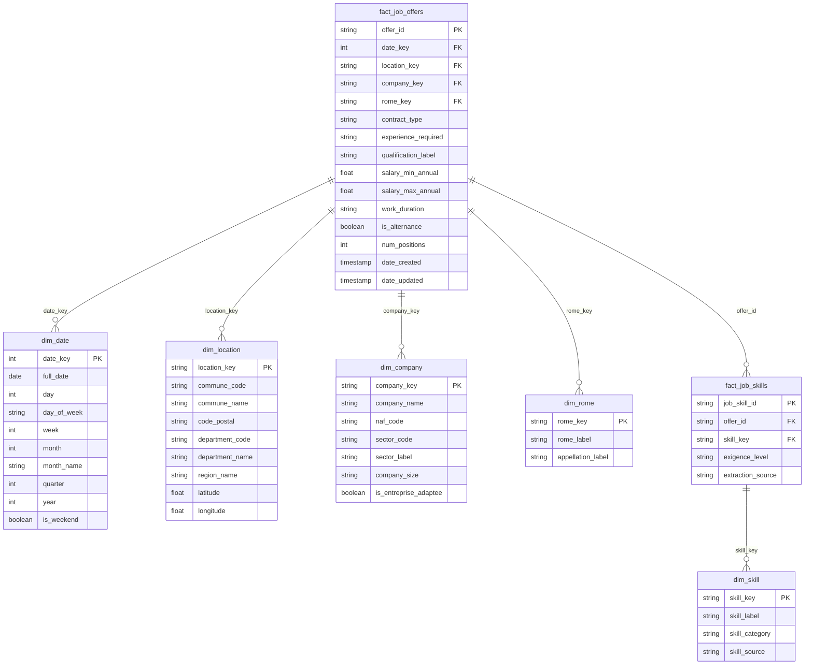
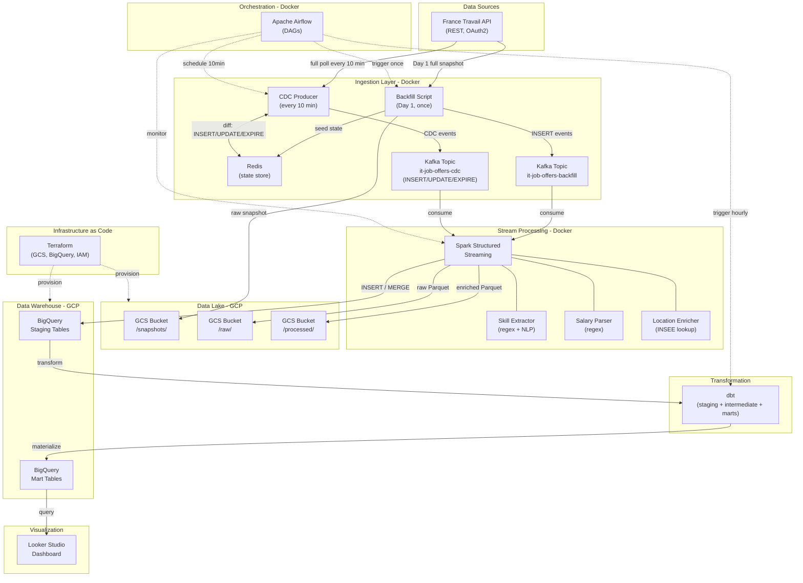
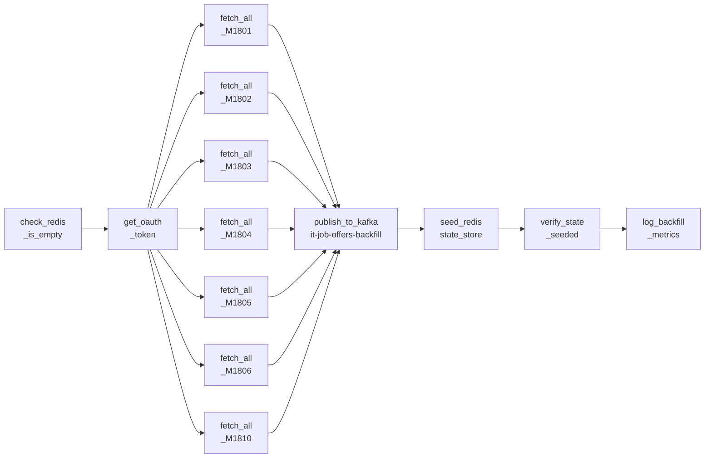
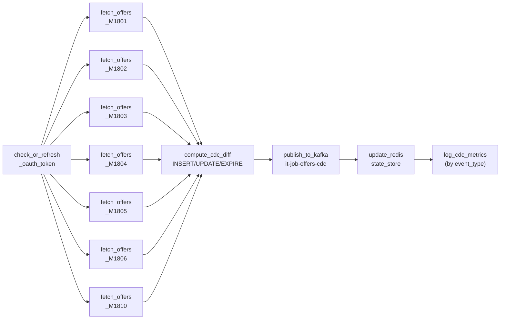
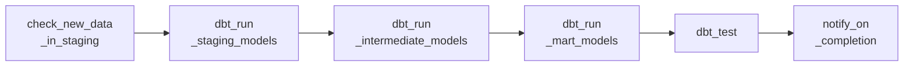
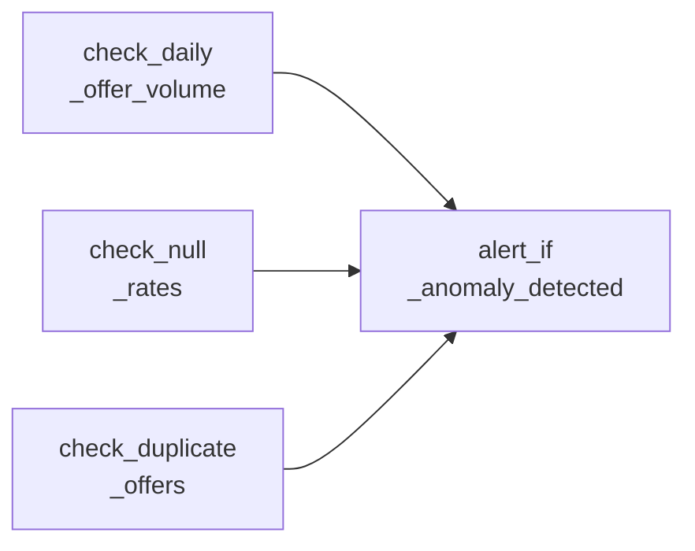
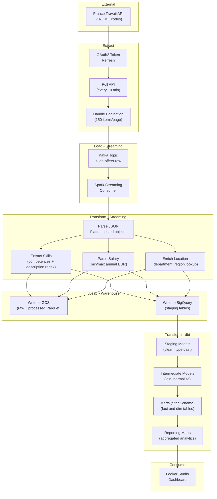

# Chapter I. System Design

## Table of Contents

- [A. What is the Data Source?](#a-what-is-the-data-source)
- [B. What data does the API return?](#b-what-data-does-the-api-return)
- [C. When to query the API?](#c-when-to-query-the-api)
- [D. What is the data scope?](#d-what-is-the-data-scope)
- [E. How much data needs to be processed?](#e-how-much-data-needs-to-be-processed)
- [F. Business requirements](#f-business-requirements)
- [G. What data to extract? (Dimension and Fact tables)](#g-what-data-to-extract)
- [H. Star Schema](#h-star-schema)
- [I. ELT System Design](#i-elt-system-design)
- [J. DAG Design](#j-dag-design)
- [K. Data Flow Diagram](#k-data-flow-diagram)
- [L. CDC Pattern](#L-cdc-pattern)

---

## A. What is the Data Source?

The data source is the **France Travail API** (formerly Pole Emploi), the official public employment service of France. France Travail collects and publishes job offers from employers across the country, making them available through a REST API.

### API: Offres d'emploi v2


| Property                  | Value                                                                                   |
| ------------------------- | --------------------------------------------------------------------------------------- |
| **Endpoint**              | `https://api.francetravail.io/partenaire/offresdemploi/v2/offres/search`                |
| **Protocol**              | REST (HTTPS)                                                                            |
| **Response format**       | JSON                                                                                    |
| **Authentication**        | OAuth2 Client Credentials Grant                                                         |
| **Token endpoint**        | `https://entreprise.francetravail.fr/connexion/oauth2/access_token?realm=%2Fpartenaire` |
| **Scopes**                | `api_offresdemploiv2 o2dsoffre`                                                         |
| **Rate limit**            | 10 requests/second                                                                      |
| **Max items per request** | 3,000 (paginated via `range` header)                                                    |
| **Availability**          | 99.8% uptime                                                                            |
| **Cost**                  | Free (open access with registration)                                                    |
| **Registration**          | [francetravail.io/data/api](https://francetravail.io/data/api)                          |
| **Python SDK**            | `france-travail-api` ([PyPI](https://pypi.org/project/france-travail-api/))             |


### Authentication Flow

```
Client (Python Producer)
    |
    |--- POST /connexion/oauth2/access_token
    |    Body: grant_type=client_credentials
    |          &client_id=<ID>
    |          &client_secret=<SECRET>
    |          &scope=api_offresdemploiv2 o2dsoffre
    |
    v
Token Server (entreprise.francetravail.fr)
    |
    |--- Response: { "access_token": "...", "expires_in": 1499 }
    |
    v
Client uses Bearer token for API calls (~25 min validity)
```

---

## B. What data does the API return?

The API returns a JSON object with two top-level keys:

- `resultats`: array of job offer objects
- `filtresPossibles`: array of aggregation facets (counts by contract type, experience, qualification, etc.)

### Job Offer Fields

Below is the complete field structure of a single job offer, documented from real API responses captured on 2026-03-20.

#### Core Information


| Field               | Type     | Example                      | Description                                                                          |
| ------------------- | -------- | ---------------------------- | ------------------------------------------------------------------------------------ |
| `id`                | string   | `"205RVSM"`                  | Unique offer identifier                                                              |
| `intitule`          | string   | `"Developpeur Java (H/F)"`   | Job title                                                                            |
| `description`       | string   | *(long text)*                | Full job description (free text, can contain tech stack, responsibilities, benefits) |
| `dateCreation`      | ISO 8601 | `"2026-03-19T15:37:24.267Z"` | Date the offer was first published                                                   |
| `dateActualisation` | ISO 8601 | `"2026-03-19T15:48:17.597Z"` | Date the offer was last updated                                                      |


#### Location (`lieuTravail` object)


| Field        | Type   | Example             | Description                               |
| ------------ | ------ | ------------------- | ----------------------------------------- |
| `libelle`    | string | `"67 - STRASBOURG"` | Location label (department number + city) |
| `latitude`   | float  | `48.592028`         | GPS latitude                              |
| `longitude`  | float  | `7.696481`          | GPS longitude                             |
| `codePostal` | string | `"67000"`           | French postal code                        |
| `commune`    | string | `"67482"`           | INSEE commune code                        |


#### Company (`entreprise` object)


| Field               | Type    | Example                           | Description                                                                   |
| ------------------- | ------- | --------------------------------- | ----------------------------------------------------------------------------- |
| `nom`               | string  | `"ECONOCOM SERVICES & SOLUTIONS"` | Company name                                                                  |
| `entrepriseAdaptee` | boolean | `false`                           | Whether the company is an "entreprise adaptee" (adapted for disabled workers) |


#### Job Classification


| Field                | Type   | Example                                          | Description                                 |
| -------------------- | ------ | ------------------------------------------------ | ------------------------------------------- |
| `romeCode`           | string | `"M1805"`                                        | ROME code (national job classification)     |
| `romeLibelle`        | string | `"Developpeur / Developpeuse informatique"`      | ROME category label                         |
| `appellationlibelle` | string | `"Analyste developpeur / Analyste developpeuse"` | Specific job title within the ROME category |


#### Contract Details


| Field                         | Type    | Example             | Description                                                          |
| ----------------------------- | ------- | ------------------- | -------------------------------------------------------------------- |
| `typeContrat`                 | string  | `"CDI"`             | Contract type code: CDI, CDD, MIS (interim), LIB (freelance), CCE    |
| `typeContratLibelle`          | string  | `"CDI"`             | Contract type label (may include duration, e.g. "Interim - 18 Mois") |
| `natureContrat`               | string  | `"Contrat travail"` | Nature of contract                                                   |
| `dureeTravailLibelle`         | string  | `"37H/semaine"`     | Working hours description                                            |
| `dureeTravailLibelleConverti` | string  | `"Temps plein"`     | Converted work duration: "Temps plein" or "Temps partiel"            |
| `alternance`                  | boolean | `false`             | Whether the position is an apprenticeship/alternance                 |


#### Experience & Qualifications


| Field                  | Type   | Example     | Description                                                                                                                                                                          |
| ---------------------- | ------ | ----------- | ------------------------------------------------------------------------------------------------------------------------------------------------------------------------------------ |
| `experienceExige`      | string | `"E"`       | Experience requirement: **E** = Exige (required), **S** = Souhaite (desired), **D** = Debutant accepte (beginner OK)                                                                 |
| `experienceLibelle`    | string | `"3 An(s)"` | Experience level description                                                                                                                                                         |
| `qualificationCode`    | string | `"9"`       | Qualification code                                                                                                                                                                   |
| `qualificationLibelle` | string | `"Cadre"`   | Qualification label: Manoeuvre, Ouvrier specialise, Ouvrier qualifie (P1,P2), Ouvrier qualifie (P3,P4), Employe non qualifie, Employe qualifie, Technicien, Agent de maitrise, Cadre |


#### Skills (`competences` array)

Each element describes a required or desired skill:


| Field      | Type   | Example             | Description                                          |
| ---------- | ------ | ------------------- | ---------------------------------------------------- |
| `code`     | string | `"300688"`          | Skill reference code                                 |
| `libelle`  | string | `"Application web"` | Skill label                                          |
| `exigence` | string | `"S"`               | Requirement level: **E** = required, **S** = desired |


#### Salary (`salaire` object)


| Field              | Type   | Example                                                   | Description                                                         |
| ------------------ | ------ | --------------------------------------------------------- | ------------------------------------------------------------------- |
| `libelle`          | string | `"Annuel de 36000.0 Euros a 40000.0 Euros sur 12.0 mois"` | Salary description (structured text: annual/monthly, range, period) |
| `commentaire`      | string | `"a negocier selon le profil"`                            | Free-text salary comment                                            |
| `complement1`      | string | `"Interessement / participation"`                         | Additional compensation #1                                          |
| `complement2`      | string | `"CSE"`                                                   | Additional compensation #2                                          |
| `listeComplements` | array  | *(see below)*                                             | Structured list of salary complements                               |


Each element in `listeComplements`:


| Field     | Type   | Example                           |
| --------- | ------ | --------------------------------- |
| `code`    | string | `"10"`                            |
| `libelle` | string | `"Interessement / participation"` |


#### Training (`formations` array)


| Field            | Type   | Example                          | Description                                  |
| ---------------- | ------ | -------------------------------- | -------------------------------------------- |
| `codeFormation`  | string | `"31067"`                        | Formation reference code                     |
| `domaineLibelle` | string | `"Developpement informatique"`   | Training domain                              |
| `niveauLibelle`  | string | `"Bac+5 et plus ou equivalents"` | Education level required                     |
| `exigence`       | string | `"E"`                            | Requirement level: E = required, S = desired |


#### Languages (`langues` array)


| Field      | Type   | Example     | Description       |
| ---------- | ------ | ----------- | ----------------- |
| `libelle`  | string | `"Anglais"` | Language name     |
| `exigence` | string | `"E"`       | Requirement level |


#### Driving License (`permis` array)


| Field      | Type   | Example                | Description       |
| ---------- | ------ | ---------------------- | ----------------- |
| `libelle`  | string | `"B - Vehicule leger"` | License type      |
| `exigence` | string | `"S"`                  | Requirement level |


#### Professional Qualities (`qualitesProfessionnelles` array)


| Field         | Type   | Example                                                        | Description         |
| ------------- | ------ | -------------------------------------------------------------- | ------------------- |
| `libelle`     | string | `"Organiser son travail selon les priorites et les objectifs"` | Quality name        |
| `description` | string | *(long text)*                                                  | Quality description |


#### Sector & Company Size


| Field                    | Type   | Example                                   | Description                     |
| ------------------------ | ------ | ----------------------------------------- | ------------------------------- |
| `codeNAF`                | string | `"62.03Z"`                                | NAF activity code (French NACE) |
| `secteurActivite`        | string | `"62"`                                    | Sector code                     |
| `secteurActiviteLibelle` | string | `"Gestion d'installations informatiques"` | Sector label                    |
| `trancheEffectifEtab`    | string | `"100 a 199 salaries"`                    | Company size bracket            |


#### Other Fields


| Field                   | Type    | Example    | Description                                                        |
| ----------------------- | ------- | ---------- | ------------------------------------------------------------------ |
| `nombrePostes`          | integer | `1`        | Number of open positions                                           |
| `accessibleTH`          | boolean | `false`    | Accessible to disabled workers                                     |
| `deplacementCode`       | string  | `"1"`      | Travel requirement code                                            |
| `deplacementLibelle`    | string  | `"Jamais"` | Travel requirement label: Jamais, Ponctuels, Frequents, Quotidiens |
| `contact`               | object  | *(varies)* | Contact info (nom, coordonnees, courriel, urlPostulation)          |
| `origineOffre`          | object  | *(varies)* | Offer origin (origine code, urlOrigine)                            |
| `offresManqueCandidats` | boolean | `false`    | Whether the offer lacks candidates                                 |
| `contexteTravail`       | object  | *(varies)* | Work context (horaires array)                                      |
| `entrepriseAdaptee`     | boolean | `false`    | Adapted company flag                                               |
| `employeurHandiEngage`  | boolean | `false`    | Employer disability commitment                                     |


### Aggregation Facets (`filtresPossibles`)

The response also includes aggregated counts, useful for understanding the overall distribution:

**Contract type breakdown (for ROME M1805):**


| Code | Label               | Count |
| ---- | ------------------- | ----- |
| CDI  | Permanent contract  | 472   |
| CDD  | Fixed-term contract | 74    |
| MIS  | Interim / Temporary | 73    |
| LIB  | Freelance           | 19    |
| CCE  | Short-term contract | 2     |


---

## C. When to query the API?

The ingestion strategy consists of two phases: a **one-time full backfill** on Day 1, followed by **continuous CDC (Change Data Capture)** polling every 10 minutes.

### Phase 1 — Initial Backfill (Day 1, run once)

On first launch, we perform a full snapshot of all currently active IT/data offers to establish a historical baseline before streaming begins.

| Parameter | Value | Rationale |
| --------- | ----- | --------- |
| **Trigger** | `dag_backfill_initial` (`@once`) | Runs a single time before CDC starts |
| **Scope** | All 7 ROME codes, fully paginated | Captures ~10,000–12,000 active offers |
| **Kafka topic** | `it-job-offers-backfill` | Separate topic to isolate bulk load from CDC stream |
| **State seeding** | Writes all offer IDs + `dateActualisation` to Redis | Establishes baseline for CDC diff computation |
| **GCS snapshot** | `gs://french-it-jobs-lake/snapshots/YYYY-MM-DD/` | Durable raw backup of Day 1 state |

```
Day 1 Backfill Workflow:
  1. Obtain OAuth2 token
  2. For each ROME code (M1801, M1802, M1803, M1804, M1805, M1806, M1810):
     a. Paginate through ALL results (150 items/page, up to ~1,500-2,000 per ROME code)
     b. Publish each offer as an INSERT event to Kafka topic "it-job-offers-backfill"
     c. SADD offer ID to Redis Set "active_offer_ids"
     d. HSET offer ID → dateActualisation in Redis Hash "offer_timestamps"
  3. Mark backfill complete (redis.set "backfill_completed_at")
  4. Log total offers ingested per ROME code
```

### Phase 2 — CDC Polling (every 10 minutes, ongoing)

After backfill, the CDC producer runs every 10 minutes and detects three types of changes by comparing the full API response against the Redis state store:

| CDC Event | Detection | Meaning |
| --------- | --------- | ------- |
| `INSERT`  | ID in API response but NOT in Redis | New offer just published |
| `UPDATE`  | ID in both, but `dateActualisation` changed | Offer was modified (title, salary, etc.) |
| `EXPIRE`  | ID in Redis but NOT in API response | Offer filled, withdrawn, or expired |

| Parameter | Value | Rationale |
| --------- | ----- | --------- |
| **Polling interval** | Every 10 minutes | Balances freshness with rate limits; headroom within 10 req/sec limit |
| **Trigger** | `dag_cdc_ingest` (cron `*/10 * * * *`) | Airflow manages scheduling, retries, and monitoring |
| **State store** | Redis (Docker) | O(1) set difference for `INSERT`/`EXPIRE` detection at ~12,000 IDs |
| **Token refresh** | Every ~20 minutes | Token expires in 1499 seconds (~25 min); refresh proactively |
| **Pagination** | `range=0-149`, then `150-299`, etc. | API returns max 150 items per page; full poll required for EXPIRE detection |
| **Kafka topic** | `it-job-offers-cdc` | All three event types published with `event_type` discriminator field |

```
CDC Workflow (every 10 minutes):
  1. Check if OAuth2 token is still valid; refresh if needed
  2. For each ROME code (parallel): fetch ALL current offers (fully paginated)
     → build current_offers dict: {offer_id: dateActualisation}
  3. Load state from Redis:
     → current_ids  = set(current_offers.keys())
     → stored_ids   = redis.smembers("active_offer_ids")
  4. Compute diff:
     → new_ids      = current_ids - stored_ids          (INSERT events)
     → expired_ids  = stored_ids  - current_ids         (EXPIRE events)
     → updated_ids  = {id for id in current_ids & stored_ids
                        if current_offers[id] != redis.hget("offer_timestamps", id)}
  5. Publish to Kafka "it-job-offers-cdc":
     → INSERT events: full offer payload
     → UPDATE events: full offer payload
     → EXPIRE events: offer_id only (payload = null)
  6. Update Redis state atomically:
     → SADD "active_offer_ids" new_ids
     → SREM "active_offer_ids" expired_ids
     → HSET "offer_timestamps" for new + updated offers
     → HDEL "offer_timestamps" for expired offers
  7. Log metrics: inserts, updates, expires, errors per ROME code
```

---

## D. What is the data scope?

### Geographic Scope

All of metropolitan France and overseas departments (DOM-TOM). Job offers include GPS coordinates (`latitude`, `longitude`), postal codes, and INSEE commune codes, enabling geographic analysis at city, department, and region level.

### Job Category Scope

We focus on **IT/Technology jobs** identified by ROME codes in the M18xx family. ROME (Repertoire Operationnel des Metiers et des Emplois) is the French national job classification system maintained by France Travail.


| ROME Code | Label (FR)                                           | Label (EN)                        | Description                                                                                                                   |
| --------- | ---------------------------------------------------- | --------------------------------- | ----------------------------------------------------------------------------------------------------------------------------- |
| **M1801** | Administration de systemes d'information             | Systems Administration            | Administers hardware/software elements (networks, databases, messaging). Ensures data coherence, accessibility, and security. |
| **M1802** | Expertise et support en systemes d'information       | IT Support & Expertise            | Advises on technical solutions, provides support to dev and ops teams. Ensures quality and security standards compliance.     |
| **M1803** | Direction des systemes d'information                 | IT Management / CTO               | Strategic management of IT systems, budget, teams, and digital transformation.                                                |
| **M1804** | Etudes et developpement de reseaux de telecoms       | Telecom Network Engineering       | Design, development, and optimization of telecommunication networks.                                                          |
| **M1805** | Etudes et developpement informatique                 | Software Development              | Design, develop, test, and maintain software applications. The largest IT category.                                           |
| **M1806** | Conseil et maitrise d'ouvrage en SI                  | IT Consulting / Business Analysis | Advises organizations on IT strategy, manages projects from business requirements to delivery.                                |
| **M1810** | Production et exploitation de systemes d'information | IT Operations / SRE               | Ensures availability of servers, storage, and production systems. Monitors operations and security norms.                     |


### Time Scope

- **Start date**: From project launch, continuously ingesting new offers
- **Historical data**: Not available via the API (only active/current offers are returned)
- **Retention**: Offers typically remain active for 30-60 days before being removed

---

## E. How much data needs to be processed?

### Current Active Offers (snapshot from 2026-03-20)


| ROME Code | Active Offers |
| --------- | ------------- |
| M1801     | 453           |
| M1802     | 467           |
| M1803     | 220           |
| M1804     | 473           |
| M1805     | 640           |
| M1806     | 726           |
| M1810     | 721           |
| **Total** | **~3,700**    |


### Volume Estimation


| Metric                          | Estimate       | Basis                                                                        |
| ------------------------------- | -------------- | ---------------------------------------------------------------------------- |
| **New offers per day (all IT)** | ~300-500       | Based on M1805 alone having ~~59,770/year (~~164/day); 7 ROME codes combined |
| **Updated offers per day**      | ~200-400       | Offers are frequently refreshed (dateActualisation changes)                  |
| **JSON size per offer**         | ~2-5 KB        | Measured from real API responses                                             |
| **Daily raw data volume**       | ~1-3 MB        | 500 new + 400 updated offers x ~3 KB average                                 |
| **Monthly raw data volume**     | ~30-90 MB      |                                                                              |
| **Annual raw data volume**      | ~400 MB - 1 GB |                                                                              |
| **API calls per 10-min cycle**  | ~30-50         | 7 ROME codes x ~4-7 pages each (150 items/page)                              |


This volume is modest and fits comfortably within:

- GCS free tier (5 GB storage)
- BigQuery free tier (10 GB storage, 1 TB queries/month)
- Kafka single-broker setup

---

## F. Business Requirements

From the data collected, we define 5 analytical problems to solve. These drive the design of Dimension/Fact tables and the data warehouse schema.

### BR1: Tech Skill Demand Analysis

- Which technologies are most in demand across French IT job postings? (e.g., Python, Java, JavaScript, AWS, Docker, Kubernetes, SQL, React, Angular, etc.)
- How does skill demand change over time (weekly, monthly trends)?
- Which skills are "required" (`exigence=E`) vs. "desired" (`exigence=S`)?
- What emerging skills are gaining traction?

**Data needed**: `competences[]`, `description` (for NLP/regex extraction), `dateCreation`

### BR2: Salary Analysis

- What are the salary ranges for IT jobs by region, experience level, and contract type?
- How do salaries differ between ROME categories (sysadmin vs. developer vs. IT manager)?
- Which tech skills correlate with higher salaries?
- What additional compensation is commonly offered (participation, CSE, meal vouchers)?

**Data needed**: `salaire` (libelle, commentaire, listeComplements), `lieuTravail`, `experienceExige`, `qualificationLibelle`, `romeCode`

### BR3: Contract Type Distribution

- What is the CDI vs. CDD vs. interim vs. freelance breakdown for IT jobs?
- How does contract type distribution vary by region?
- Are CDI positions growing or declining relative to other types?
- What is the alternance (apprenticeship) share in IT?

**Data needed**: `typeContrat`, `alternance`, `lieuTravail`, `dateCreation`

### BR4: Geographic Analysis

- Where are IT jobs concentrated across France? (Ile-de-France dominance vs. regional hubs)
- Which cities/departments have the highest IT job density?
- Are there emerging tech hubs outside Paris?
- How does job density correlate with company size?

**Data needed**: `lieuTravail` (latitude, longitude, codePostal, commune), `trancheEffectifEtab`

### BR5: Experience & Qualification Analysis

- What seniority levels are most in demand (beginner accepted vs. 1-3 years vs. 5+ years)?
- What education levels are required (Bac+2, Bac+3, Bac+5)?
- How do experience requirements correlate with salary?
- Which ROME categories are most open to beginners?

**Data needed**: `experienceExige`, `experienceLibelle`, `qualificationLibelle`, `formations[]`, `salaire`

---

## G. What data to extract?

Based on the business requirements, we design Dimension and Fact tables for the data warehouse.

### Dimension Tables

#### 1. `dim_date`


| Column        | Type         | Description                     |
| ------------- | ------------ | ------------------------------- |
| `date_key`    | INTEGER (PK) | Surrogate key (YYYYMMDD format) |
| `full_date`   | DATE         | Full date                       |
| `day`         | INTEGER      | Day of month (1-31)             |
| `day_of_week` | STRING       | Day name (Monday-Sunday)        |
| `week`        | INTEGER      | ISO week number                 |
| `month`       | INTEGER      | Month (1-12)                    |
| `month_name`  | STRING       | Month name                      |
| `quarter`     | INTEGER      | Quarter (1-4)                   |
| `year`        | INTEGER      | Year                            |
| `is_weekend`  | BOOLEAN      | Saturday or Sunday              |


#### 2. `dim_location`


| Column            | Type        | Description                                      |
| ----------------- | ----------- | ------------------------------------------------ |
| `location_key`    | STRING (PK) | Surrogate key (based on commune code)            |
| `commune_code`    | STRING      | INSEE commune code                               |
| `commune_name`    | STRING      | City/commune name                                |
| `code_postal`     | STRING      | Postal code                                      |
| `department_code` | STRING      | Department number (e.g., "75", "67")             |
| `department_name` | STRING      | Department name (e.g., "Paris", "Bas-Rhin")      |
| `region_name`     | STRING      | Region name (e.g., "Ile-de-France", "Grand Est") |
| `latitude`        | FLOAT       | GPS latitude                                     |
| `longitude`       | FLOAT       | GPS longitude                                    |


#### 3. `dim_company`


| Column                  | Type        | Description                                                  |
| ----------------------- | ----------- | ------------------------------------------------------------ |
| `company_key`           | STRING (PK) | Surrogate key (hash of company name + NAF code)              |
| `company_name`          | STRING      | Company name                                                 |
| `naf_code`              | STRING      | NAF activity code (e.g., "62.03Z")                           |
| `sector_code`           | STRING      | Sector code (e.g., "62")                                     |
| `sector_label`          | STRING      | Sector label (e.g., "Gestion d'installations informatiques") |
| `company_size`          | STRING      | Size bracket (e.g., "100 a 199 salaries")                    |
| `is_entreprise_adaptee` | BOOLEAN     | Adapted company flag                                         |


#### 4. `dim_rome`


| Column              | Type        | Description                    |
| ------------------- | ----------- | ------------------------------ |
| `rome_key`          | STRING (PK) | ROME code (e.g., "M1805")      |
| `rome_label`        | STRING      | ROME category label            |
| `appellation_label` | STRING      | Specific job title within ROME |


#### 5. `dim_skill`


| Column           | Type        | Description                                                                   |
| ---------------- | ----------- | ----------------------------------------------------------------------------- |
| `skill_key`      | STRING (PK) | Skill code or hash of skill label                                             |
| `skill_label`    | STRING      | Skill name (e.g., "Python", "Java", "Application web")                        |
| `skill_category` | STRING      | Category: language, framework, cloud, database, tool, methodology, soft_skill |
| `skill_source`   | STRING      | Where extracted from: "competences_field" or "description_nlp"                |


### Fact Tables

#### 6. `fact_job_offers`


| Column                | Type         | Description                              |
| --------------------- | ------------ | ---------------------------------------- |
| `offer_id`            | STRING (PK)  | France Travail offer ID                  |
| `date_key`            | INTEGER (FK) | Reference to `dim_date`                  |
| `location_key`        | STRING (FK)  | Reference to `dim_location`              |
| `company_key`         | STRING (FK)  | Reference to `dim_company`               |
| `rome_key`            | STRING (FK)  | Reference to `dim_rome`                  |
| `contract_type`       | STRING       | CDI, CDD, MIS, LIB, CCE                  |
| `contract_type_label` | STRING       | Full contract type label                 |
| `contract_nature`     | STRING       | Nature of contract                       |
| `experience_required` | STRING       | E (required), S (desired), D (beginner)  |
| `experience_label`    | STRING       | e.g., "3 An(s)", "Debutant accepte"      |
| `qualification_code`  | STRING       | Qualification code                       |
| `qualification_label` | STRING       | e.g., "Cadre", "Technicien"              |
| `salary_text`         | STRING       | Raw salary libelle                       |
| `salary_min_annual`   | FLOAT        | Parsed minimum annual salary (EUR)       |
| `salary_max_annual`   | FLOAT        | Parsed maximum annual salary (EUR)       |
| `education_level`     | STRING       | Parsed from `formations[].niveauLibelle` |
| `work_duration`       | STRING       | "Temps plein" or "Temps partiel"         |
| `is_alternance`       | BOOLEAN      | Apprenticeship flag                      |
| `is_accessible_th`    | BOOLEAN      | Disability accessibility                 |
| `travel_requirement`  | STRING       | Jamais, Ponctuels, Frequents, Quotidiens |
| `num_positions`       | INTEGER      | Number of open positions                 |
| `date_created`        | TIMESTAMP    | Original offer creation timestamp        |
| `date_updated`        | TIMESTAMP    | Last update timestamp                    |
| `is_active`           | BOOLEAN      | `TRUE` until an EXPIRE CDC event fires   |
| `ingested_at`         | TIMESTAMP    | When first inserted (backfill or INSERT CDC event) |
| `last_seen_at`        | TIMESTAMP    | Timestamp of last CDC poll that returned this offer |
| `date_expired`        | TIMESTAMP    | When EXPIRE event was received (NULL if still active) |
| `offer_lifetime_days` | INTEGER      | Computed by dbt: `date_expired - ingested_at` in days (NULL if active) |


#### 7. `fact_job_skills`


| Column              | Type        | Description                              |
| ------------------- | ----------- | ---------------------------------------- |
| `job_skill_id`      | STRING (PK) | Composite key (offer_id + skill_key)     |
| `offer_id`          | STRING (FK) | Reference to `fact_job_offers`           |
| `skill_key`         | STRING (FK) | Reference to `dim_skill`                 |
| `exigence_level`    | STRING      | E (required), S (desired)                |
| `extraction_source` | STRING      | "api_competences" or "description_regex" |


---

## H. Star Schema



### Reporting Marts (Business Analytics)

Built on top of the Star Schema, we materialize several aggregated reporting views to directly serve the Looker Studio dashboard, answering the defined Business Requirements:

- `mart_skill_demand`: Aggregation of skill counts, trends over time, and requirement levels (BR1).
- `mart_salary_analysis` / `mart_salary_by_region`: Median and average salaries sliced by region, experience, contract type, and skill (BR2).
- `mart_contract_distribution`: Job posting breakdown by CDI, CDD, Freelance, etc., across regions (BR3).
- `mart_geographic_overview`: Job counts by department and region to visualize geographic density (BR4).
- `mart_offer_lifecycle`: Average time-to-fill (offer lifetime) by ROME code and contract type, proving out the CDC flow.


### BigQuery Optimization


| Table             | Partitioning            | Clustering                                  | Rationale                                                                             |
| ----------------- | ----------------------- | ------------------------------------------- | ------------------------------------------------------------------------------------- |
| `fact_job_offers` | `date_created` (DAY)    | `rome_key`, `contract_type`, `location_key` | Most queries filter by date range and slice by job category, contract type, or region |
| `fact_job_skills` | `offer_id` (hash-based) | `skill_key`, `exigence_level`               | Queries join on offer_id and filter by skill                                          |


---

## I. ELT System Design

### Architecture Diagram




### ELT Tools


| Layer                 | Tool                        | Purpose                                                               |
| --------------------- | --------------------------- | --------------------------------------------------------------------- |
| **Infrastructure**    | Terraform                   | Provision GCS buckets, BigQuery datasets, service accounts, IAM roles |
| **Containerization**  | Docker + docker-compose     | Run Kafka, Redis, Spark, Airflow locally; reproducible environment    |
| **Ingestion**         | Python + `httpx`/`requests` | Backfill + CDC poll of France Travail API; handle OAuth2, pagination  |
| **State Store**       | Redis (Docker)              | Track active offer IDs and timestamps; O(1) set diff for CDC computation |
| **Message Broker**    | Apache Kafka (KRaft mode)   | Two topics: `it-job-offers-backfill` (Day 1) + `it-job-offers-cdc` (ongoing) |
| **Stream Processing** | Spark Structured Streaming  | Route CDC events (INSERT/UPDATE/EXPIRE); extract skills; normalize salary; MERGE into BigQuery |
| **Data Lake**         | Google Cloud Storage (GCS)  | `/snapshots/` (Day 1), `/raw/` (ongoing), `/processed/` (enriched Parquet) |
| **Data Warehouse**    | Google BigQuery             | Analytical queries; Dimensional model (Star schema) with CDC lifecycle columns |
| **Transformation**    | dbt                         | Staging, intermediate, marts (Star Schema), and reporting (`mart_offer_lifecycle`, `mart_salary_analysis`, etc.) |
| **Orchestration**     | Apache Airflow              | `dag_backfill_initial` (once) + `dag_cdc_ingest` (10 min) + `dag_dbt_transform` (hourly) |
| **Dashboard**         | Looker Studio               | Skill demand, salary trends, geographic distribution, offer lifecycle |


### GCS Bucket Layout

```
gs://french-it-jobs-lake/
    snapshots/                          ← Day 1 full backfill (written once)
        2026-03-23/
            M1801_snapshot.json
            M1802_snapshot.json
            ...
            M1810_snapshot.json
    raw/                                ← Ongoing CDC raw events (INSERT/UPDATE/EXPIRE)
        year=2026/
            month=03/
                day=23/
                    cdc-2026-03-23T14-30-00.json   ← includes event_type in each record
                    cdc-2026-03-23T14-40-00.json
                    ...
    processed/                          ← Enriched Parquet (INSERT + UPDATE events only)
        year=2026/
            month=03/
                day=23/
                    job_offers/
                        part-00000.parquet
                    job_skills/
                        part-00000.parquet
```

---

## J. DAG Design

### DAG 0: `dag_backfill_initial` (runs `@once` on Day 1)



### DAG 1: `dag_cdc_ingest` (runs every 10 minutes, cron `*/10 * * * *`)




### DAG 2: `dag_dbt_transform` (runs hourly)




### DAG 3: `dag_data_quality` (runs daily)




---

## K. Data Flow Diagram

### End-to-End Data Lineage




### Data Transformation Details


| Stage                         | Input                                                                                    | Transformation                                                                                                                                             | Output                                                        |
| ----------------------------- | ---------------------------------------------------------------------------------------- | ---------------------------------------------------------------------------------------------------------------------------------------------------------- | ------------------------------------------------------------- |
| **Skill Extraction**          | `competences[]` array + `description` free text                                          | 1. Map `competences[].libelle` directly as API skills. 2. Apply regex patterns on `description` to extract tech keywords (Python, Java, AWS, Docker, etc.) | `fact_job_skills` records with `extraction_source` tag        |
| **Salary Parsing**            | `salaire.libelle` string (e.g., "Annuel de 36000.0 Euros a 40000.0 Euros sur 12.0 mois") | Regex to extract min/max values and period (annual/monthly/hourly). Normalize all to annual EUR.                                                           | `salary_min_annual`, `salary_max_annual` in `fact_job_offers` |
| **Location Enrichment**       | `lieuTravail.codePostal`, `lieuTravail.commune`                                          | Map commune/postal codes to department and region using INSEE reference data                                                                               | `dim_location` with `department_name`, `region_name`          |
| **Experience Classification** | `experienceExige` + `experienceLibelle`                                                  | Map codes (E/S/D) and parse years from libelle                                                                                                             | Standardized experience level in `fact_job_offers`            |


---

## Appendix: Sample API Response

Below is a real API response for a "Developpeur Java" position captured on 2026-03-20:

```json
{
  "id": "205RVSM",
  "intitule": "Developpeur Java (H/F)",
  "description": "Au sein d'une societe de courtage d'assurance, vous integrerez une equipe de developpeurs... L'environnement technique: Java, Spring Boot, framework JS, Broker (RabbitMQ, Kafka, JMS), base de donnees (SQL Server, MongoDB), jUnit, Git, IntelliJ, Maven, Sonar, Jenkins, Ansible, JIRA, Confluence.",
  "dateCreation": "2026-03-19T15:37:24.267Z",
  "dateActualisation": "2026-03-19T15:48:17.597Z",
  "lieuTravail": {
    "libelle": "67 - STRASBOURG",
    "latitude": 48.592028,
    "longitude": 7.696481,
    "codePostal": "67000",
    "commune": "67482"
  },
  "romeCode": "M1805",
  "romeLibelle": "Developpeur / Developpeuse informatique",
  "appellationlibelle": "Developpeur / Developpeuse informatique",
  "entreprise": {
    "nom": "ECONOCOM SERVICES & SOLUTIONS",
    "entrepriseAdaptee": false
  },
  "typeContrat": "CDI",
  "typeContratLibelle": "CDI",
  "natureContrat": "Contrat travail",
  "experienceExige": "E",
  "experienceLibelle": "3 An(s)",
  "formations": [
    {
      "codeFormation": "31067",
      "domaineLibelle": "Developpement informatique",
      "niveauLibelle": "Bac+5 et plus ou equivalents",
      "exigence": "E"
    }
  ],
  "competences": [
    { "code": "300688", "libelle": "Application web", "exigence": "S" },
    { "code": "109846", "libelle": "Concevoir une application web", "exigence": "S" }
  ],
  "salaire": {
    "libelle": "Annuel de 36000.0 Euros a 40000.0 Euros sur 12.0 mois",
    "complement1": "Interessement / participation",
    "complement2": "CSE",
    "listeComplements": [
      { "code": "10", "libelle": "Interessement / participation" },
      { "code": "9", "libelle": "CSE" },
      { "code": "6", "libelle": "Titres restaurant / Prime de panier" },
      { "code": "12", "libelle": "Plan d'epargne retraite d'entreprise" }
    ]
  },
  "dureeTravailLibelle": "37H/semaine",
  "dureeTravailLibelleConverti": "Temps plein",
  "alternance": false,
  "nombrePostes": 1,
  "accessibleTH": false,
  "deplacementLibelle": "Jamais",
  "qualificationCode": "9",
  "qualificationLibelle": "Cadre",
  "codeNAF": "62.03Z",
  "secteurActivite": "62",
  "secteurActiviteLibelle": "Gestion d'installations informatiques",
  "trancheEffectifEtab": "100 a 199 salaries"
}
```

---

## L. CDC Pattern

### Why CDC for a REST API?

The France Travail API does not support webhooks or change streams — it only returns the current active state. To implement CDC on top of a polling REST API, we maintain our own state store (Redis) and compute the diff between consecutive full snapshots.

This is the **Snapshot Diff CDC** pattern, distinct from database CDC (which reads transaction logs). It is the standard approach for APIs that expose a "current active records" endpoint without a changelog.

### Event Types

| Event | Trigger | Kafka Payload |
| ----- | ------- | ------------- |
| `INSERT` | Offer ID appears in API but not in Redis | Full offer JSON |
| `UPDATE` | Offer ID in both, `dateActualisation` changed | Full offer JSON |
| `EXPIRE` | Offer ID in Redis but missing from API | `offer_id` only (no payload) |

### Kafka Message Envelope

Every message on both `it-job-offers-backfill` and `it-job-offers-cdc` uses this schema:

```json
{
  "event_type": "INSERT",
  "event_timestamp": "2026-03-23T10:00:00.000Z",
  "offer_id": "205RVSM",
  "offer": {
    "id": "205RVSM",
    "intitule": "Developpeur Java (H/F)",
    ...
  }
}
```

For `EXPIRE` events, `offer` is `null`:

```json
{
  "event_type": "EXPIRE",
  "event_timestamp": "2026-03-23T10:10:00.000Z",
  "offer_id": "205RVSM",
  "offer": null
}
```

### Redis State Store Design

Two Redis data structures maintained by the CDC producer:

| Key | Type | Content | Purpose |
| --- | ---- | ------- | ------- |
| `active_offer_ids` | Set | All currently active offer IDs | O(1) set diff for INSERT/EXPIRE detection |
| `offer_timestamps` | Hash | `{offer_id: dateActualisation}` | UPDATE detection: compare stored vs current timestamp |
| `backfill_completed_at` | String | ISO timestamp | Guard: CDC producer refuses to run until backfill is confirmed |

### Spark CDC Routing

Spark reads from both Kafka topics and routes by `event_type`:

| `event_type` | Spark Action | BigQuery Operation |
| ------------ | ------------ | ------------------ |
| `INSERT` | Parse + enrich full offer | `INSERT` new row (`is_active=TRUE`, `ingested_at=now()`) |
| `UPDATE` | Parse + enrich updated offer | `MERGE` on `offer_id` (update enriched fields + `last_seen_at` + `date_updated`) |
| `EXPIRE` | No enrichment needed | `MERGE` on `offer_id` (set `is_active=FALSE`, `date_expired=now()`) |

### BigQuery MERGE Pattern (EXPIRE)

```sql
MERGE INTO `french_it_jobs.stg_job_offers` AS target
USING (SELECT @offer_id AS offer_id, @expired_at AS date_expired) AS source
ON target.offer_id = source.offer_id
WHEN MATCHED THEN UPDATE SET
  target.is_active = FALSE,
  target.date_expired = source.date_expired;
```

### dbt Lifecycle Model

`mart_offer_lifecycle` computes offer time-to-fill as a proxy metric:

```sql
SELECT
  rome_key,
  contract_type,
  COUNT(*)                                         AS total_offers,
  COUNTIF(is_active = FALSE)                       AS expired_offers,
  AVG(offer_lifetime_days)                         AS avg_lifetime_days,
  APPROX_QUANTILES(offer_lifetime_days, 4)[OFFSET(2)] AS median_lifetime_days
FROM {{ ref('int_active_offers') }}
WHERE date_expired IS NOT NULL
GROUP BY 1, 2
```

### Failure & Recovery

| Failure Scenario | Recovery Strategy |
| ---------------- | ----------------- |
| Producer crash mid-cycle | Redis state is only updated atomically at end of cycle; next run recomputes diff cleanly |
| Redis data loss | Re-run backfill script with `--force-reseed` flag to rebuild state from BigQuery `stg_job_offers` |
| Spark consumer lag | Kafka retains messages for 7 days; Spark resumes from last committed offset |
| BigQuery MERGE failure | Idempotent: replay the Kafka offset; MERGE is safe to re-run |

